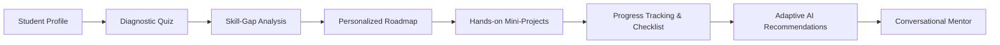

# SkillPath AI — Personalized Career Learning Path Generator
> **Intelligent, Transparent, and Project-Driven Career Roadmap Platform for College Students & Beginners**  
> *Developed for the NxtWave MCP Mega Workshop Project Challenge (Project 5: Learning Path Generator)*

[](https://www.python.org/)
[](https://flask.palletsprojects.com/)
[](https://www.sqlite.org/)
[-purple.svg)](https://modelcontextprotocol.io/)
[](LICENSE)

---

## 📌 Executive Summary

### The Core Student Problem
College students and tech aspirants often find themselves trapped in "tutorial hell": they want to become Full-Stack Developers, Data Analysts, or AI Engineers, but face overwhelming, conflicting tutorials. They don't know:
1. What skills they are genuinely missing versus industry benchmarks.
2. In what logical order concepts must be mastered (e.g., JavaScript async before React, SQL schema before complex backend microservices).
3. How to realistically pace their study hours across college semesters without burning out.
4. What hands-on mini-projects impress hiring managers during internship interviews.

### The SkillPath Promise
> *"Tell us where you are and where you want to go. SkillPath AI will help you discover the gap and create a practical roadmap to get there."*

SkillPath AI provides a complete end-to-end journey:


---

## 🚀 Key Features

### 🌟 Feature A: Professional Landing Page
- Clean, responsive productivity interface with deep charcoal typography (`#0f172a`), restrained indigo accent (`#4f46e5`), and neutral card layouts.
- Interactive curriculum preview of a 4-stage Full-Stack roadmap.
- Real-world student case study ("Alex Chen: From 2nd Year CSE to Full-Stack Developer").
- 1-click **"Explore Demo Profile"** button allowing reviewers to test without manually filling forms.

### 👤 Feature B: Student Profile & Onboarding
- Flexible profile capture: Education level (1st-4th Year B.Tech, BCA, MCA, Self-taught), daily study hours (0.5 to 12 hrs), target preparation deadline (weeks), and preferred learning style.
- Supported Career Paths:
  - **Full-Stack Developer**
  - **Python Developer**
  - **Data Analyst**
  - **AI/ML Engineer**
  - **Java Developer**
  - **Backend Developer**
  - **Custom Career Goal** (allows personalized tech roles)
- Self-assessed skill baseline chip selectors.

### 📝 Feature C: Diagnostic Skill Assessment
- Curated, foundational multiple-choice questions for each supported career path.
- Evaluates core concepts (e.g., semantic HTML, JS type coercion, REST idempotent methods, SQL aggregation, ACID properties).
- Tracks correct/incorrect answers and calculates a percentage breakdown by skill category.
- Stored separately in `assessment_data.py`. No randomized or fabricated test scores.

### 📊 Feature D: Deterministic Skill-Gap Analysis
- Transparent recommendation engine comparing student self-assessment and diagnostic quiz scores against industry target benchmarks.
- For every skill:
  - **Estimated Current Score** (0–100%)
  - **Target Benchmark Score** (0–100%)
  - **Gap Severity**: `None`, `Minor`, `Moderate`, or `Critical`
  - **Priority Level**: `High`, `Medium`, `Low`, or `Completed`
  - **Industry Rationale**: Plain-English explanation of why the skill matters for the target role.
- Workload feasibility reconciler: compares total required curriculum hours against the student's available daily hours and target weeks, flagging `Realistic`, `Challenging`, or `Unrealistic` schedules with actionable advice.

### 🗺️ Feature E: Personalized Learning Roadmap
- Sequential stages respecting prerequisite order (Foundations ➔ Core Logic ➔ Backend/DB ➔ Integration & Cloud).
- Every stage contains:
  - Stage learning objectives and estimated completion hours.
  - Verified reputable free resources with working direct links (MDN Web Docs, Python.org, FreeCodeCamp, W3Schools, CS50, PostgreSQL Tutorial, Kaggle).
  - Hands-on mini-project specification.
  - Interactive, real-time checklist.

### 🤖 Feature F: Dual-Mode AI Career Mentor
- Context-aware conversational assistant embedded as a sliding drawer on every page.
- Aware of student name, career goal, active stage, roadmap progress percentage, and recent quiz score.
- Modes:
  - **Online LLM API**: Connects to Groq (`llama-3.3-70b-versatile`), Google Gemini (`gemini-1.5-flash`), or OpenAI (`gpt-4o-mini`) via server-side Flask calls. API keys are never exposed to the frontend.
  - **Built-in Offline Rule-Based Mentor**: When no API key is configured or when offline, the platform provides high-quality guidance with real-life analogies, project hints, and mock interview questions clearly labeled as `[SkillPath Built-in Mentor (Offline Rule-Based Mode)]`.

### 📈 Feature G: Live Dashboard & Real-Time Checklist
- Live completion percentage and task counter dynamically recalculated via asynchronous `fetch()` API whenever a task is marked complete or pending.
- Progress survives application restarts through SQLite database persistence.

### ⚡ Feature H: Adaptive Recommendations Engine
- Dynamically responds to student behavior:
  - If a student scores < 60% in a diagnostic quiz category, surfaces a **Diagnostic Alert** recommending targeted revision before proceeding.
  - Recommends the immediate prerequisite task to unlock the stage mini-project.
  - If schedule is tight or behind, surfaces a **Pacing Adjustment** recommendation.

### 🛠️ Feature I: Interview-Ready Mini-Projects
- Each stage features a practical mini-project specification:
  - Project Title & Problem Statement
  - Skills Practiced & Difficulty Level
  - Core Functional Requirements
  - Optional Stretch Goals
  - Suggested Completion Criteria

### 🔌 Feature J: Model Context Protocol (MCP) Integration
- Includes a complete standard `mcp_server.py` communicating over JSON-RPC 2.0 stdio.
- Exposes 5 MCP tools (`get_available_careers`, `get_diagnostic_assessment`, `generate_learning_roadmap`, `analyze_skill_gaps`, `ask_career_mentor`) for Cursor AI, Claude Desktop, and Pipedream workflows.

---

## 🏗️ Architecture & Technology Stack

| Layer | Technology | Rationale |
|---|---|---|
| **Frontend** | HTML5, CSS3, Vanilla JavaScript | Fast, zero build step, easily inspectable by beginners and reviewers |
| **Backend** | Python 3.10+ with Flask 3.1 | Clean route separation, lightweight, easy to explain during interviews |
| **Database** | SQLite3 (`skillpath.db`) | Zero configuration, relational integrity with foreign keys, portable |
| **Protocol** | Model Context Protocol (MCP) | Direct JSON-RPC integration with Cursor AI and LLM agents |
| **AI Integration** | REST API (Groq, Gemini, OpenAI) + Offline Fallback | Reliable operation regardless of API key availability or network limits |
| **Testing** | Pytest 9.2 | Automated unit and integration test suite |

### Project Directory Structure
```
brave-rutherford/
├── app.py                      # Flask routes, sessions, REST endpoints
├── database.py                 # SQLite database access layer, schema & demo seeder
├── assessment_data.py          # Career benchmarks, diagnostic quizzes & verified links
├── recommendation_engine.py    # Deterministic skill-gap & feasibility math, adaptive rules
├── ai_mentor.py                # Online LLM caller + offline rule-based mentor
├── mcp_server.py               # MCP Server for Cursor AI & Pipedream tools
├── requirements.txt            # Project dependencies
├── .env.example                # Template for configuration
├── .gitignore                  # Git ignore rules
├── static/
│   ├── css/
│   │   └── style.css           # Responsive design system
│   └── js/
│       ├── app.js              # Real-time task toggle & progress synchronization
│       ├── assessment.js       # Diagnostic quiz engine & score calculator
│       └── mentor.js           # Conversational AI drawer & quick prompt pills
├── templates/
│   ├── base.html               # Base layout, navbar, footer & AI drawer
│   ├── index.html              # Landing page & student journey showcase
│   ├── onboarding.html         # Student profile setup & goal selection
│   ├── assessment.html         # Diagnostic quiz interface
│   ├── gap_analysis.html       # Skill-gap visualization & comparison bars
│   ├── roadmap.html            # Dashboard, roadmap stages, checklist & mini-projects
│   ├── profile.html            # Pacing adjustment & reset settings
│   └── error.html              # Clean 404/500 error views
├── tests/
│   └── test_skillpath.py       # Comprehensive unit and integration test suite
└── .cursor/
    └── mcp.json                # Cursor AI MCP configuration
```

---

## 💻 Windows Setup & Installation Guide

### Step 1: Open Terminal in Project Directory
Open PowerShell or Command Prompt in the repository folder:
```powershell
cd "c:\Users\Sarani Nowbattu\Documents\antigravity\brave-rutherford"
```

### Step 2: Create & Activate Virtual Environment
```powershell
python -m venv venv
.\venv\Scripts\Activate.ps1
```
*(If PowerShell displays an execution policy error, run `Set-ExecutionPolicy -ExecutionPolicy RemoteSigned -Scope CurrentUser`)*

### Step 3: Install Required Dependencies
```powershell
pip install -r requirements.txt
```

### Step 4: Configure Environment Variables
Copy the example environment file:
```powershell
copy .env.example .env
```
By default, `.env` is set to `AI_PROVIDER=none`, which runs the intelligent offline built-in mentor.

*(Optional)* To use an online LLM:
- **Groq (Free & Fast)**: Set `AI_PROVIDER=groq`, `AI_API_KEY=gsk_...`, `AI_MODEL=llama-3.3-70b-versatile`
- **Google Gemini**: Set `AI_PROVIDER=gemini`, `AI_API_KEY=AIzaSy...`, `AI_MODEL=gemini-1.5-flash`
- **OpenAI**: Set `AI_PROVIDER=openai`, `AI_API_KEY=sk-...`, `AI_MODEL=gpt-4o-mini`

### Step 5: Run the Application
```powershell
python app.py
```
Open your browser and navigate to:
👉 **`http://127.0.0.1:5000`**

---

## 🧪 Testing & Verification

SkillPath AI includes a comprehensive test suite in `tests/test_skillpath.py` covering skill-gap math, quiz scoring, feasibility calculations, SQLite persistence, and mentor fallback behavior.

To execute the test suite:
```powershell
.\venv\Scripts\python.exe -m pytest -v
```

### Test Results Summary:
```
tests/test_skillpath.py::test_skill_gap_calculation_basic PASSED         [  9%]
tests/test_skillpath.py::test_skill_gap_blended_with_quiz PASSED         [ 18%]
tests/test_skillpath.py::test_feasibility_realistic PASSED               [ 27%]
tests/test_skillpath.py::test_feasibility_unrealistic PASSED             [ 36%]
tests/test_skillpath.py::test_adaptive_recommendations_weak_quiz PASSED  [ 45%]
tests/test_skillpath.py::test_database_init_and_seed PASSED              [ 54%]
tests/test_skillpath.py::test_task_toggle_persistence PASSED             [ 63%]
tests/test_skillpath.py::test_mentor_fallback_mode PASSED                [ 72%]
tests/test_skillpath.py::test_homepage_route PASSED                      [ 81%]
tests/test_skillpath.py::test_demo_login_route PASSED                    [ 90%]
tests/test_skillpath.py::test_api_mentor_chat PASSED                     [100%]

============================= 11 passed in 0.42s ==============================
```

To test the MCP server tools independently:
```powershell
.\venv\Scripts\python.exe mcp_server.py --test
```

---

## 🎮 Reviewer Demo Guide (1-Minute Walkthrough)

To quickly evaluate the full user journey during an evaluation or interview:

1. Open `http://127.0.0.1:5000`.
2. Click **"Demo Profile"** in the top navbar or the hero section.
3. You are instantly logged in as **Alex Chen (2nd Year CSE targeting Full-Stack Developer)**.
4. **Observe the Dashboard**:
   - Notice the live progress bar (31.6%), adaptive recommendations alert, and 4 sequential stages.
   - Click any checkbox under Stage 2 (Core JavaScript). Notice how the overall progress percentage updates in real time without a page reload!
5. **Inspect Skill Gaps**: Click **"View Skill Gaps"** in the navbar to see the visual comparison bars (estimated score vs industry target) and schedule feasibility alert.
6. **Chat with AI Mentor**: Click the purple **"Ask Mentor"** button at the bottom-right.
   - Click the prompt pill: *"Give me a hint on my current stage project"*.
   - Ask: *"Explain REST APIs with a real-life analogy"*.
   - Notice the beginner-friendly response tailored specifically to Alex's roadmap.

---

## 📱 Model Context Protocol (MCP) Integration with Cursor AI

This repository includes `.cursor/mcp.json` configured for Cursor AI.
When opened in Cursor IDE:
1. Open Cursor Settings ➔ **MCP Servers**.
2. Cursor will detect `skillpath-learning-path-generator` via `mcp_server.py`.
3. In Cursor Composer or Chat, you can prompt:
   - *"Use SkillPath MCP tool to generate a 12-week roadmap for Python Developer studying 2 hours a day."*
   - *"Analyze skill gaps for Full-Stack Developer with beginner JavaScript and intermediate SQL."*

---

## 📢 LinkedIn Post Submission Draft

Use this ready-to-post content for your NxtWave Mega Workshop submission:

```markdown
🚀 Excited to share my final project submission for the NxtWave MCP Mega Workshop: SkillPath AI — Personalized Career Learning Path Generator! 🎓💡

As a student, one of the biggest challenges isn't finding tutorials—it's knowing what to learn, in what order, and how to pace yourself without burnout.

To solve this, I built SkillPath AI, an intelligent career mentor that helps students go from where they are to where they want to be.

Key Features Built:
✅ Diagnostic Skill Assessment: Real multiple-choice quizzes that test foundational understanding.
✅ Deterministic Skill-Gap Analysis: Calculates exact gaps against industry benchmarks and evaluates schedule feasibility.
✅ Personalized Adaptive Roadmaps: Sequential learning stages with verified free resources and hands-on mini-projects.
✅ Dual-Mode AI Career Mentor: Powered by LLM APIs with an intelligent offline rule-based fallback mode.
✅ Model Context Protocol (MCP) Server: Exposes learning path tools directly to Cursor AI and LLM workflows.

Tech Stack:
💻 Python, Flask, SQLite, Vanilla JavaScript, HTML5, CSS3, MCP Protocol, Pytest.

A big thank you to the NxtWave team for hosting the MCP Mega Workshop! 

#NxtWave #MegaWorkshop #MCP #CursorAI #ModelContextProtocol #WebDevelopment #Python #Flask #AI #PortfolioProject #StudentsInTech
```

---

## 📄 License
This project is open-source under the MIT License. Developed for educational, portfolio, and submission purposes.
